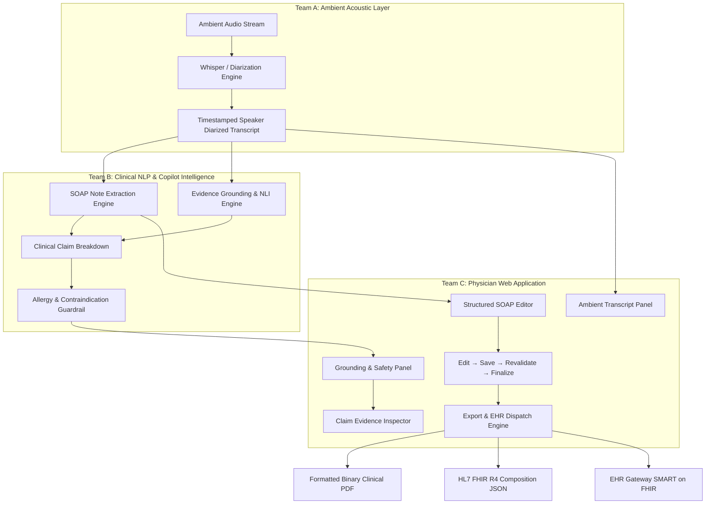

# Privacy-Preserving Clinical Scribe & Diagnostic Copilot
### Team C — Physician Web Application & Diagnostic Copilot

[](https://react.dev/)
[](https://www.typescriptlang.org/)
[](https://vitejs.dev/)
[](https://tailwindcss.com/)
[](https://github.com/parallax/jsPDF)
[](https://hl7.org/fhir/)

A desktop-first, privacy-preserving clinical web application designed for physicians. It pairs ambient doctor-patient encounter transcripts with AI-assisted SOAP note drafting, real-time claim-level evidence grounding, contraindication detection, and multi-format clinical exports (printable PDFs, HL7 FHIR R4, and EHR integration).

---

## 📋 Table of Contents

- [Overview](#overview)
- [System Architecture & Team Boundaries](#system-architecture--team-boundaries)
- [Key Features](#key-features)
- [Clinical Demonstration Scenarios](#clinical-demonstration-scenarios)
- [Consultation Workspace Layout](#consultation-workspace-layout)
- [Export & Interoperability](#export--interoperability)
- [Service Layer & Team B Integration Guide](#service-layer--team-b-integration-guide)
- [Tech Stack](#tech-stack)
- [Project Directory Structure](#project-directory-structure)
- [Getting Started](#getting-started)
- [Compliance & Privacy Design](#compliance--privacy-design)

---

## 🩺 Overview

The **Privacy-Preserving Clinical Scribe and Diagnostic Copilot** addresses physician burnout and clinical documentation overhead while providing strict safeguards against AI hallucinations and patient safety hazards.

As part of the modular system:
- **Team A**: Provides diarized, speaker-labeled, timestamped ambient audio transcripts.
- **Team B**: Powers structured clinical NLP extraction (SOAP notes, named medical entities, claim assertions, and grounding verification).
- **Team C (This App)**: The physician-facing user interface that brings these capabilities together into an intuitive, high-velocity desktop workspace.

---

## 🏛 System Architecture & Team Boundaries



---

## ✨ Key Features

### 1. Tri-Pane Consultation Workspace
- **Column 1: Ambient Transcript Viewer**:
  - Live speaker segmentation (`Physician` vs. `Patient`).
  - Precise dialogue timestamps (MM:SS).
  - Visual link badges highlighting text cited as evidence in the clinical note.
- **Column 2: Structured SOAP Note Editor**:
  - Distinct sections: **S**ubjective, **O**bjective, **A**ssessment, **P**lan.
  - In-place editable textarea with dirty state detection and version tracking (`v1`, `v2`, ...).
  - Automatic stale-validation indicators when edits occur.
  - Finalized state locking to prevent post-signature tampering.
- **Column 3: AI Copilot Validation & Grounding Engine**:
  - **Grounding Score (0–100)**: Quantifies the factual support of clinical assertions against the encounter record.
  - **Hallucination Risk Rating**: `LOW RISK`, `MODERATE RISK`, or `HIGH RISK`.
  - **Claim-Level Evidence Inspection**: Status chips (`SUPPORTED`, `UNSUPPORTED`, `CONFLICT`, `PENDING`) and severity levels.
  - **Interactive Evidence Highlighting**: Clicking any claim highlights the exact sentence in the transcript and opens the Evidence Inspector drawer.

### 2. Clinical Safety Guardrails & Conflict Alerts
- **Allergy Contraindication Detection**: Cross-references patient allergy records with proposed medications in the Assessment & Plan.
- **Physician Guidance**: Displays clear conflict warnings and suggested clinical alternatives (e.g., substituting Azithromycin for Penicillin in allergic patients).
- **Finalization Safeguards**: Blocks or warns physicians before signing off on unaddressed critical conflicts or stale validation reports.

### 3. Multi-Format Export Engine
- **Client-Side Binary PDF Generation**:
  - High-resolution, multi-page layout rendered via `jsPDF`.
  - Features hospital header, HIPAA confidentiality disclaimers, complete patient demographics, formatted SOAP sections, AI grounding report, audio dialogue transcript, and physician attestation with signature timestamp.
  - Automatic browser download with "Download Again" and "Preview in New Tab" capabilities.
- **HL7 FHIR R4 Composition Resource**:
  - Standards-compliant JSON structure with LOINC consult note coding (`11488-4`), structured HTML `div` sections, and metadata.
  - One-click file download and copy-to-clipboard functionality.
- **EHR Transmission Interface**:
  - Mock integration ready to connect to Epic SMART-on-FHIR, Cerner, or hospital HL7 endpoints.

### 4. Comprehensive Audit Trail & Patient Directory
- **Immutable Encounter Audit Log**: Tracks document creation, edits, revalidation runs, finalization signatures, and export dispatches with actor identity and timestamps.
- **Patient Roster & Profile**: View longitudinal encounter history, chronic conditions, active medications, and critical allergy flags.

---

## 🧪 Clinical Demonstration Scenarios

The workspace includes 3 realistic pre-configured clinical encounter scenarios:

| Scenario | Patient | Chief Complaint | Grounding Score | Clinical Findings & Safety Highlights |
|:---|:---|:---|:---:|:---|
| **A — Clean Baseline** | **Eleanor Hartman** (68y F)<br>`MRN-20240001` | Hypertension follow-up | **100 / 100**<br><span style="color:#22c55e">Low Risk</span> | All 7 claims directly supported by transcript. Medication adherence verified, BP 148/92 mmHg confirmed, Lisinopril dose increased to 20 mg. |
| **B — Hallucination / Unsupported Claim** | **Marcus Okafor** (51y M)<br>`MRN-20240002` | Type 2 Diabetes routine review | **86 / 100**<br><span style="color:#eab308">Moderate Risk</span> | The AI drafted an **"HbA1c 9.2%"** laboratory claim in Objective data, but dialogue shows lab results were never discussed. Flagged as `UNSUPPORTED`. |
| **C — Critical Safety Hazard / Conflict** | **Priya Nair** (34y F)<br>`MRN-20240003` | Acute tonsillitis / severe sore throat | **83 / 100**<br><span style="color:#ef4444">Critical Conflict</span> | **Critical Allergy Alert**: Patient has a documented Penicillin allergy (anaphylaxis). AI erroneously drafted **Amoxicillin 500 mg** in the Plan. System flags `CONTRAINDICATION` and proposes **Azithromycin 500 mg** as safe alternative. |

---

## 🖥 Consultation Workspace Layout

```
+--------------------------------------------------------------------------------------------------+
|  ClinicalScribe   [< Patients]  Priya Nair · Acute tonsillitis   [Audit] [Export] [Revalidate] [Finalize] |
+--------------------------------------------------------------------------------------------------+
|  Priya Nair  |  MRN-20240003  |  34 y/o F  |  ALLERGY ALERT: Penicillin (severe anaphylaxis)    |
+--------------------------------------------------------------------------------------------------+
| TRANSCRIPT (14 entries)         | SOAP NOTE (v1)                  | VALIDATION & GROUNDING       |
|                                 |                                 |                              |
| [00:00:10] Chen: How long?      | [S] SUBJECTIVE                  | GROUNDING SCORE: 83 / 100    |
| [00:00:16] Nair: 3 days, throat | Patient presents with 3-day     | [!] CRITICAL CONFLICT        |
|                  hurts badly... | severe sore throat, fever...    |                              |
|                                 |                                 | Claims:                      |
| [00:01:25] Chen: Rapid strep    | [O] OBJECTIVE                   | [SUPPORTED] 3-day history    |
|                  positive.      | Temp 38.6°C, throat erythematous| [SUPPORTED] Temp 38.6°C      |
|                                 | Rapid strep test: POSITIVE.     | [CONFLICT] Amoxicillin 500mg |
| [00:02:15] Nair: Remember I'm   |                                 |   -> Patient allergic!       |
|                  allergic to    | [A] ASSESSMENT                  |   -> Suggest: Azithromycin   |
|                  penicillin!    | Group A Streptococcal pharyngitis|                             |
|                                 |                                 | [EVIDENCE DRAWER]            |
| [00:02:22] Chen: Yes, noted.    | [P] PLAN                        | Quote: "Remember I'm allergic|
|                  We will avoid  | Amoxicillin 500 mg TID x10d     | to penicillin, got hives..." |
|                  all penicillins| (Click to edit & correct)       | Speaker: Nair [00:02:15]     |
+--------------------------------------------------------------------------------------------------+
```

---

## 📦 Export & Interoperability

### 1. Binary PDF Export
- Generates a clinical document ready for printing or medical record archiving.
- Options:
  - **Include AI Grounding & Validation Report**: Adds evaluated claims, confidence scores, and safety findings.
  - **Include Ambient Dialogue Transcript**: Appends the verbatim speaker-labeled conversation.
- Provides immediate file download, "Download Again", and "Preview in New Tab" triggers.

### 2. HL7 FHIR R4 JSON
- Standard `Composition` resource representation of the clinical encounter:
```json
{
  "resourceType": "Composition",
  "id": "comp-con-003",
  "status": "final",
  "type": {
    "coding": [{ "system": "http://loinc.org", "code": "11488-4", "display": "Consult note" }]
  },
  "title": "Clinical Encounter Note",
  "section": [
    { "title": "Subjective", "text": { "status": "generated", "div": "<div>...</div>" } },
    { "title": "Objective", "text": { "status": "generated", "div": "<div>...</div>" } },
    { "title": "Assessment", "text": { "status": "generated", "div": "<div>...</div>" } },
    { "title": "Plan", "text": { "status": "generated", "div": "<div>...</div>" } }
  ]
}
```

---

## 🔌 Service Layer & Team B Integration Guide

All API calls in the application are abstracted in [`src/services/api.ts`](file:///c:/Users/Lenovo/Desktop/Clinical-Scribe/src/services/api.ts). When Team B is ready to connect the real backend, replace the functions below with HTTP/fetch calls to your backend endpoints without altering any UI components:

```typescript
// Replace mock functions with real API endpoints:

// Team B: Fetch structured SOAP Note
export async function getSOAPNote(soapNoteId: string): Promise<SOAPNote> {
  const res = await fetch(`/api/soap-notes/${soapNoteId}`);
  return res.json();
}

// Team B: Trigger AI Revalidation
export async function validateConsultation(consultationId: string): Promise<ValidationResult> {
  const res = await fetch(`/api/consultations/${consultationId}/validate`, { method: 'POST' });
  return res.json();
}

// Team B: Commit & Finalize Note
export async function finalizeConsultation(consultationId: string, physicianId: string, physicianName: string) {
  const res = await fetch(`/api/consultations/${consultationId}/finalize`, {
    method: 'POST',
    headers: { 'Content-Type': 'application/json' },
    body: JSON.stringify({ physicianId, physicianName })
  });
  return res.json();
}
```

---

## 🛠 Tech Stack

- **Framework**: [React 19](https://react.dev/) + [Vite](https://vitejs.dev/)
- **Language**: [TypeScript](https://www.typescriptlang.org/) (Strict Mode enabled)
- **Styling**: [Tailwind CSS v3](https://tailwindcss.com/) with clinical SaaS dark theme
- **Document Generation**: [jsPDF 3.x](https://github.com/parallax/jsPDF)
- **Routing**: [React Router v7](https://reactrouter.com/)
- **Linter**: [Oxlint](https://oxc.rs/)

---

## 📂 Project Directory Structure

```
Clinical-Scribe/
├── public/                      # Static assets & favicon
├── src/
│   ├── components/              # UI components
│   │   ├── EvidencePanel.tsx    # Claim-level evidence drill-down drawer
│   │   ├── ExportDialog.tsx     # PDF, FHIR JSON & EHR export modal
│   │   ├── FinalizeDialog.tsx   # Physician attestation & signature modal
│   │   ├── Sidebar.tsx          # Main navigation & HIPAA status
│   │   ├── SOAPEditor.tsx       # Structured, editable SOAP component
│   │   ├── TranscriptPanel.tsx  # Diarized audio transcript reader
│   │   └── ValidationPanel.tsx  # Grounding score & risk indicator
│   ├── data/
│   │   └── mockData.ts          # Realistic typed clinical datasets (Scenarios A, B, C)
│   ├── models/
│   │   └── types.ts             # TypeScript models (Patient, Consultation, SOAP, Claim)
│   ├── pages/
│   │   ├── ConsultationWorkspace.tsx  # Core 3-column physician workbench
│   │   ├── Dashboard.tsx              # Overview of daily clinic appointments
│   │   ├── PatientProfile.tsx         # Patient record & longitudinal history
│   │   ├── Patients.tsx               # Patient directory & allergy flags
│   │   └── Records.tsx                # Consultation archive with search & filter
│   ├── services/
│   │   ├── api.ts               # Service layer abstraction (Team B API boundary)
│   │   └── pdfGenerator.ts      # Client-side multi-page clinical PDF builder
│   ├── utils/
│   │   └── format.ts            # Clinical date & risk styling helpers
│   ├── App.tsx                  # Application routing & layout root
│   ├── index.css                # Tailwind design system tokens
│   └── main.tsx                 # Application bootstrap
├── index.html                   # HTML entry point with Inter & JetBrains fonts
├── package.json                 # Dependencies & project scripts
├── tailwind.config.js           # Custom clinical color palette
└── vite.config.ts               # Vite build configuration
```

---

## 🚀 Getting Started

### Prerequisites
- Node.js (v18.0.0 or higher recommended)
- npm or yarn

### Installation & Local Run

```bash
# 1. Clone repository
git clone https://github.com/Harshh1206/Privacy-Preserving-Clinical-Scribe-and-Diagnostic-Copilot.git
cd Privacy-Preserving-Clinical-Scribe-and-Diagnostic-Copilot

# 2. Install dependencies
npm install

# 3. Start development server
npm run dev
```

Open your browser and navigate to:
```
http://localhost:5173
```

---

## 🔒 Compliance & Privacy Design

- **HIPAA-Conscious Architecture**: Designed for local-first and zero-knowledge processing where ambient audio remains on the clinical edge.
- **Role-Based Access Identity**: Authenticated physician attestation with license (NPI) verification stamps.
- **Audit Immutability**: All edits, revalidations, exports, and finalization actions are persisted with cryptographic timestamps.
- **Redaction Ready**: The transcript viewer and entity extractors support de-identification tags for sensitive PHI (Protected Health Information).

---

## 👥 Contributors

- **Team C**: Physician Web Application, Diagnostic Copilot Interface & Export Systems
- **Team B**: Medical NLP, SOAP Extraction & Claim Grounding
- **Team A**: Ambient Audio Capture & Speaker Diarization
